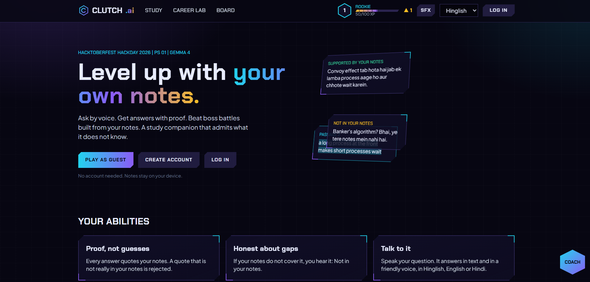
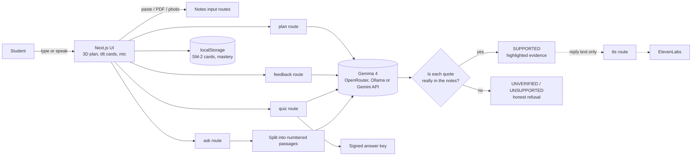
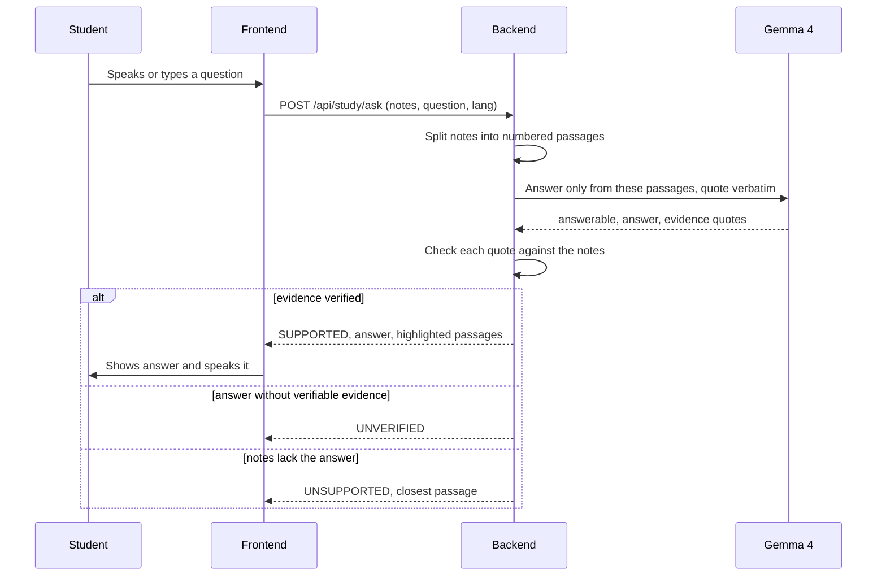
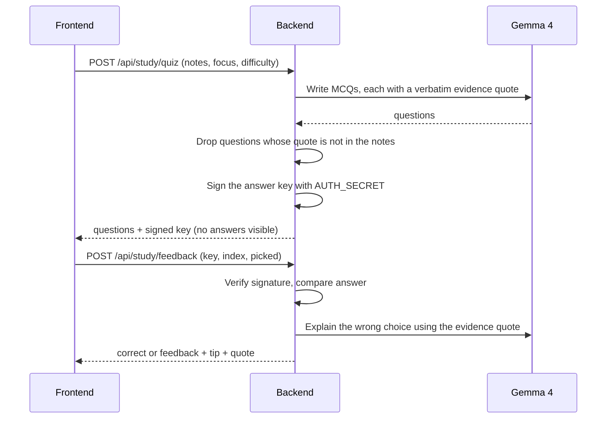

<div align="center">

<!-- Save a screenshot of the Study page as docs/hero-screenshot.png -->


# ⚡ CLUTCH.ai Study Companion

### Tere notes. Tera dost. Pure evidence.

*Ask your own notes by voice, get answers with highlighted proof, and an honest "Not in your notes" when the proof is missing.*


**Hacktoberfest Hackday 2026** · Track 1: Best Use of Gemma 4 · **PS 01: Study Companion from Real Notes**

</div>

---

## 📖 Overview

CLUTCH.ai turns your own notes into a study game. Paste, upload a PDF, or photograph notes on one topic. Ask a question by typing or **speaking**. The answer comes only from your notes, with the proof highlighted, and is read back in a friendly voice. If your notes do not contain the answer, it tells you so instead of guessing.

**Gemma 4** does the reading, answering, quiz writing, feedback and plan building. **Plain code does the checking:** it verifies every quote against your notes, drops anything unproven, signs the quiz answer key, and schedules revision.

It isn't a thin wrapper around a chat API. Every core feature is backed by a real check or algorithm:

| Feature | What's actually happening under the hood |
|---|---|
| 🔍 **Ask your notes** | Notes are split into numbered passages. Gemma must answer only from them and return verbatim quotes. Code checks each quote (exact, or 85% word match) and highlights it. |
| 🚫 **"Not in your notes"** | `UNSUPPORTED` when the notes lack the answer. `UNVERIFIED` when Gemma answers but its evidence is not found in the notes. |
| ⚔️ **Boss-battle quiz** | Generated only from your notes. Questions whose evidence quote is not in the notes are dropped. The answer key is a **signed token**, so the browser cannot read it. |
| 💡 **Wrong-answer help** | Hint button before answering. After a wrong answer Gemma explains that specific choice using the evidence quote. |
| 🔁 **Adaptive learning** | Each concept has an **SM-2** card and a 0-100 mastery level. Weak and due concepts come first, and difficulty (easy, medium, hard) follows your average mastery. |
| 🗺️ **3D study plan** | Gemma extracts 4-10 concepts with prerequisites (each must have evidence in your notes). They become an isometric 3D skill tree with a day-wise plan. |
| 🎙️ **Voice** | Mic uses the browser Web Speech API. Replies are spoken by ElevenLabs, or the browser voice when ElevenLabs is not configured. |
| 📷 **Photo notes** | Gemma 4's image understanding transcribes a photo of notes. You can edit the text before using it. |
| 🌐 **Full-UI language switch** | Hinglish, English or Hindi. The whole interface, answers, quiz feedback, plan summaries and the spoken voice follow your choice. |
| 🎮 **Game layer** | XP, levels, ranks, day streaks, daily quests, 10 badges, combo bonuses. Pure functions in `lib/game.ts`, unit-tested. |
| 🧑‍🏫 **Study Coach** | A floating coach (voice or text) that gives study strategy from your progress. It never states subject facts; those must come from your notes via Ask. |

---

## ✨ Features

- 🔐 **Evidence-first answers** — every answer shows the exact passage it came from, with the quote highlighted
- 🧪 **Code-verified quotes** — a quote that is not really in your notes is rejected, even if the model sounds confident
- 📝 **Paste, PDF or photo** notes (one topic, up to 12,000 characters)
- ⚔️ **Boss-battle quiz** — 3 hearts, combo bonus, hints, and a friend who explains your mistakes
- 🗺️ **3D skill tree** with prerequisites and a day-wise plan
- 🔁 **Spaced repetition (SM-2)** brings weak topics back at the right time
- 🎙️ **Speak your question, hear the answer** (Chrome or Edge for the mic)
- 🌐 **Hinglish / English / हिन्दी** across the whole UI
- ⚡ **Fast by design** — thinking mode off, retries, response cache, background plan pre-build
- 👤 **Guest mode** (nothing to sign up for) or optional accounts that sync progress
- 🧭 **Career Lab** (extension) — resume check, skill gap, path simulator, job-post reality check

---

## 🖥️ Tech Stack

| Layer | Technology |
|---|---|
| Frontend | Next.js 14 (App Router), React 18, TypeScript, Tailwind CSS, Framer Motion |
| 3D | Custom isometric skill tree (`components/SkillTree3D.tsx`) |
| Backend | Next.js API routes (Node.js) |
| LLM | **Gemma 4** (open-weight) via **OpenRouter**, self-hosted **Ollama**, or the **Gemini API** |
| Vision | Gemma 4 image understanding for photo notes |
| Voice | Web Speech API (mic) · ElevenLabs or browser speech (replies) |
| Spaced repetition | Custom SM-2 implementation (`lib/sm2.ts`) |
| Accounts (optional) | bcryptjs, `jose` JWT cookies, MongoDB Atlas (or in-memory for demos) |
| PDF | `pdf-parse` |

---

## 🏗️ Architecture



### 🔎 Evidence pipeline in detail



### ⚔️ Quiz and signed answer key



---

## 📁 Project Structure

```
clutch-study/
├── app/
│   ├── page.tsx                  Landing page
│   ├── study/                    Main study experience
│   ├── career/                   Career Lab (extension)
│   ├── leaderboard/, profile/    Optional account pages
│   ├── login/, register/, forgot/, reset/
│   └── api/
│       ├── study/                ask, notes, image, quiz, feedback, plan, coach, tts
│       ├── career/               resume, gap, path
│       ├── auth/, me/, state/    Accounts and progress sync
│       ├── leaderboard/
│       └── health/               Model connectivity check
├── components/
│   ├── StudyCompanion.tsx        HQ, Notes, Ask, Boss Battle, 3D Plan tabs
│   ├── SkillTree3D.tsx          Isometric 3D skill tree
│   ├── GameProvider.tsx          XP, badges, quests, language state
│   ├── Hud.tsx, NavLinks.tsx     Header, language selector
│   ├── Coach.tsx, Tour.tsx       Floating coach and first-run tour
│   └── AuthForm.tsx, Confetti.tsx, TiltCard.tsx
├── lib/
│   ├── infer.ts                  Model access: Ollama, Gemini API, OpenRouter, retry, cache
│   ├── study.ts                  Chunking and evidence check
│   ├── studyKey.ts               Signed quiz answer key
│   ├── sm2.ts                    Spaced repetition
│   ├── game.ts                   XP, levels, badges (pure functions)
│   ├── i18n.ts                   Hinglish / English / Hindi UI strings
│   ├── voice.ts, sfx.ts          Speech and sound
│   ├── persona.ts                Tutor voice per language
│   ├── resume.ts, reality.ts     Career Lab rules
│   └── db.ts, session.ts, ratelimit.ts, mail.ts, pdf.ts
├── scripts/
│   ├── logic-test.ts             Offline checks (no model needed)
│   └── eval.ts                   20-question reproducible evaluation
└── docs/                         Pitch, PPT outline, video script
```

---

## 🚀 Getting Started

### 1. Requirements
Node.js **18.18 or newer** (Node 20 LTS recommended).

### 2. Install

```bash
git clone https://github.com/YOUR_GITHUB_USERNAME/YOUR_REPO.git
cd clutch-study
npm install
```

### 3. Choose a model provider

**Option A: OpenRouter (fastest hosted, no GPU) ✅ recommended**
Get a key from <https://openrouter.ai/keys>, then in `.env`:

```env
INFERENCE_PROVIDER="openrouter"
OPENROUTER_API_KEY="your_key"
OPENROUTER_MODEL="google/gemma-4-26b-a4b-it:nitro"
```
`:nitro` picks the fastest provider. For a free (rate-limited) model use `google/gemma-4-26b-a4b-it:free`.

**Option B: Ollama (private, runs on your machine, needs a strong laptop or GPU)**

```bash
ollama pull gemma4:e4b
ollama serve
```
Keep the default Ollama values from `.env.example`.

**Option C: Gemini API (no GPU, free tier is slower)**

```env
INFERENCE_PROVIDER="gemini"
GEMINI_API_KEY="your_key"
GEMMA_API_MODEL="gemma-4-26b-a4b-it"
```
Use a Gemma model id here, not a Gemini model.

### 4. Environment

```bash
cp .env.example .env      # Windows: copy .env.example .env
```

| Variable | Purpose |
|---|---|
| `INFERENCE_PROVIDER` | `ollama` (default), `openrouter` or `gemini` |
| `OPENROUTER_API_KEY`, `OPENROUTER_MODEL` | Gemma 4 through OpenRouter |
| `GEMINI_API_KEY`, `GEMMA_API_MODEL` | Gemma 4 through the Gemini API |
| `INFERENCE_URL`, `GEMMA_MODEL`, `NUM_CTX` | Ollama address, model tag, context size |
| `AUTH_SECRET` | Signs the quiz answer key and login cookies (any long random string) |
| `MONGODB_URI` | Optional: persistent accounts. Unset = in-memory demo accounts |
| `APP_URL`, `SMTP_*`, `MAIL_FROM` | Optional: password-reset email |
| `ELEVENLABS_API_KEY`, `ELEVENLABS_VOICE_ID` | Optional: spoken replies (only the reply text is sent) |
| `RATE_LIMIT_PER_10MIN` | Per-IP request limit |

### 5. Run

```bash
npm run dev
```

- Health check: <http://localhost:3000/api/health> should show `"ok": true`
- App: <http://localhost:3000/study>

### 6. Tests

```bash
npm run test:logic    # offline checks, no model needed
npm run eval          # 20 fixed questions, needs the model
```

### Deploy on Vercel
Use OpenRouter or the Gemini API (Vercel cannot run Ollama). Add the variables from `.env.example` in the dashboard. Model routes set `maxDuration = 60`; check your plan allows it.

---

## 🎬 Demo checklist (about 4 minutes)

1. Click **Load sample notes** (synthetic CPU scheduling notes).
2. Ask by voice: *"Convoy effect kya hota hai?"* Show the highlighted evidence and let it speak.
3. Ask *"Banker's algorithm kya hai?"* and show the **Not in your notes** response.
4. Open **Boss Battle**, answer one question wrongly, read the explanation and the evidence quote.
5. Open **3D Plan**, build the plan, click a concept and watch mastery change after a quiz.
6. Switch the header language to **हिन्दी** and show the whole UI change.
7. Run `npm run eval` and show baseline vs evidence verification.

---

## ✅ PS 01 requirements

| Requirement | Where |
|---|---|
| Upload or paste notes on one topic | `components/StudyCompanion.tsx`, `app/api/study/notes`, `app/api/study/image` |
| Answers with identifiable evidence | `app/api/study/ask`, `lib/study.ts` |
| Say when notes are not enough | `UNSUPPORTED` / `UNVERIFIED` in `app/api/study/ask` |
| Practice questions and evaluation | `app/api/study/quiz`, `lib/studyKey.ts` |
| Explain wrong answers, hints | `app/api/study/feedback`, hint button in Boss Battle |
| Adapt to progress | `lib/sm2.ts`, adaptive quiz, 3D plan |
| Gemma 4 used meaningfully | `lib/infer.ts` (answer, quiz, feedback, plan, photo reading) |

---

## 🔍 How It Works (Judge / Interview Q&A)

- **Grounding** — Notes are split into numbered passages. Gemma is told to answer only from them and to return verbatim quotes. `lib/study.ts` then checks every quote against the notes (exact match, or at least 85% word overlap) and highlights it. A quote that is not found marks the answer `UNVERIFIED` and it is not shown as true.
- **Honest refusals** — If the model says the notes lack the answer, the app shows `UNSUPPORTED` with the closest passage it found. This is the "unsupported question" case from the PS 01 checklist.
- **Quiz integrity** — Each generated question carries an evidence quote. Questions whose quote is not in your notes are dropped. The correct answer is stored in a token signed with `AUTH_SECRET`, so the browser never sees it and a tampered key is rejected.
- **Wrong-answer feedback** — After a wrong pick, Gemma explains that specific option using only the evidence quote. If the model is slow or down, the stored explanation is used instead.
- **Spaced repetition** — Every quiz result becomes a 0-5 quality score fed into SM-2 (ease factor, interval, next review date). The HQ tab shows what is due today, and quiz difficulty follows your average mastery.
- **3D plan** — Gemma proposes concepts, prerequisites and a quote for each. Concepts without evidence in the notes are dropped, so the skill tree contains only what your notes really cover. Concept names are never translated, so your progress survives a language switch.
- **Language switch** — The selected language drives the whole UI, the tutor persona sent to Gemma, plan summaries, error messages and the speech voice. Notes themselves are never translated.
- **Speed** — Thinking mode is switched off where the API allows it. Transient errors (429, 5xx, bad JSON) are retried up to 3 times. Identical requests are cached for 30 minutes and identical in-flight requests are shared. After notes load, the 3D plan is built in the background so opening the tab is instant.
- **Why Gemma 4 and OpenRouter?** — Gemma 4 is an open-weight model, which is what the event asks for. OpenRouter only provides fast hosted access to the same model; the code also supports self-hosted Ollama and the Gemini API, so nothing depends on one provider.
- **Privacy** — Guest mode keeps everything in the browser. Notes are sent only to the model provider you configure. Accounts store progress, never notes.

---

## 📊 Evaluation

`npm run eval` asks **20 fixed questions** on the sample notes (10 answerable, 10 not in the notes, including failure-inducing ones) in two variants: **baseline** (no evidence check) and **with evidence verification**. It writes `eval-results.json` with the model, timestamp and every output for failure analysis.

Run `npm run eval` yourself to reproduce the results on your own model setup.

---

## 🧪 Verification status

| Check | Status |
|---|---|
| `npm run test:logic` (chunking, evidence match, SM-2, game rules, reality check, resume checks) | ✅ Passed |
| TypeScript type check and `next build` | ✅ Passed |
| Study routes against a **mock** model (supported, fuzzy match, unsupported, invented evidence caught, bad concepts and quiz questions dropped, tampered key rejected) | ✅ Passed |
| Model access layer against a **mock** server (retry on 503, plain retry on 400, bad-JSON retry, response cache, shared in-flight requests) | ✅ Passed |
| Accounts against the **in-memory** store (register, duplicate email, login, logout, state sync, leaderboard, forgot and reset, delete account) | ✅ Passed |
| MongoDB adapter with a real Atlas cluster | ⏳ Not run |
| Live Gemma 4 answers, quiz, plan, feedback and Career Lab quality | ⏳ Not run: fill in after your first run |
| `npm run eval` scores | ⏳ Not run yet |
| Look and feel across browsers: 3D tree, boss battle, mic, ElevenLabs voice, photo notes | ⏳ Partly checked by hand, not fully |
| Mobile and desktop layout check | ⏳ Not run |

---

## ⚠️ Limitations

- Notes are limited to 12,000 characters and one topic at a time. Short notes are sent whole; longer notes use keyword retrieval for the top 8 passages.
- Evidence checking proves a quote exists in the notes, not that the reasoning is correct. A human should review generated quiz questions.
- Handwriting recognition quality varies with the photo. Scanned PDFs have no text layer, so use the photo upload.
- Browser speech recognition works in Chrome and Edge only, and Hinglish accuracy varies. Voice output needs an installed system voice for the chosen language.
- Quiz questions and options stay in the language of the notes; hints and explanations follow the selected language. Career Lab, login and profile pages are not translated yet.
- Progress lives in one browser's localStorage. Clearing site data resets it.
- Sample notes are synthetic, written for this demo.

---

## 📝 Notes

- The app needs **one** working model provider to answer anything. `GET /api/health` shows whether the model is reachable and how long a tiny request took.
- Without `MONGODB_URI`, accounts live in server memory (fine for a local demo, lost on restart).
- Check the Gemma 4 model license on its OpenRouter, Ollama or Google page before redistributing weights.

---

## 📄 License

MIT. See [`LICENSE`](LICENSE).

---

<div align="center">

### Built for Hacktoberfest Hackday 2026 by **Ujjwal Sharma**

[](linkedin.com/in/ujjwal-sharma-934100379)
[](https://github.com/ujjwalsharma25)

⭐ *If this project helped you, consider giving it a star!*

</div>
